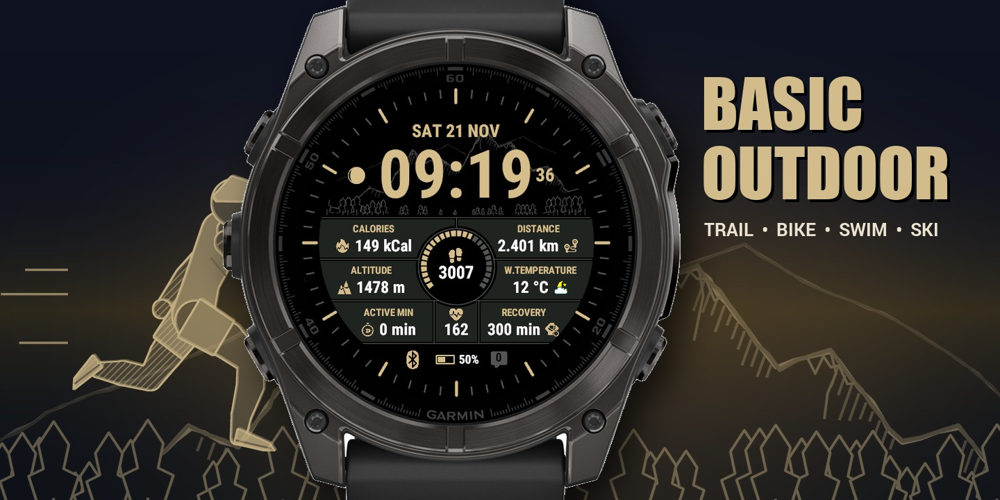
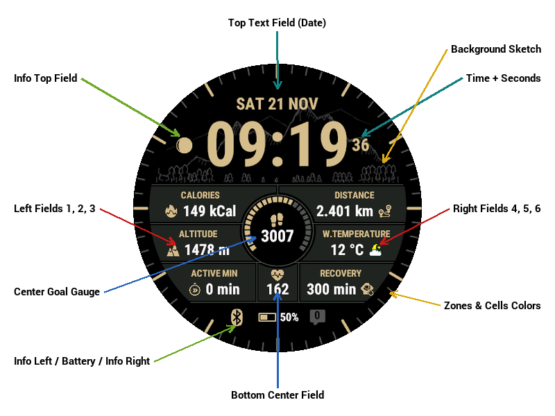
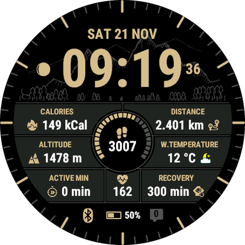
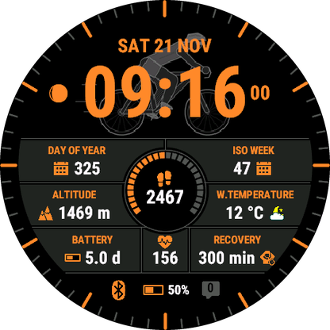
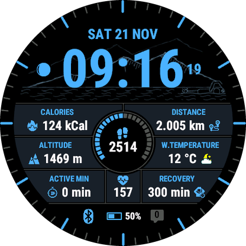
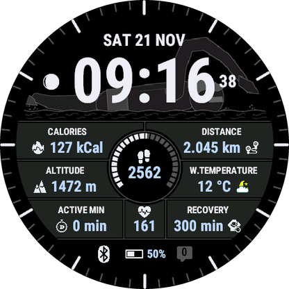
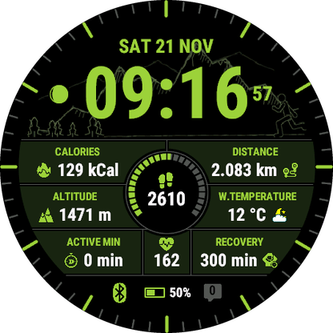
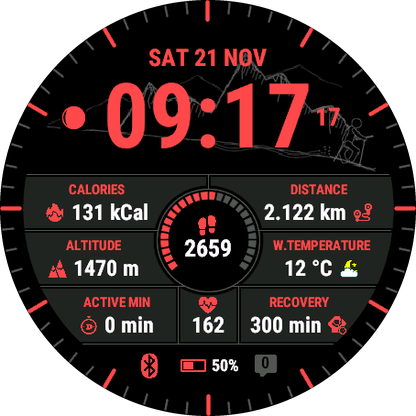
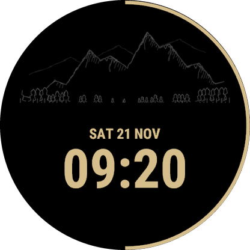
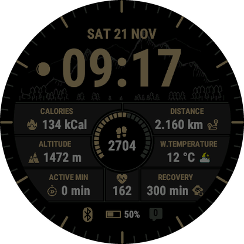

# BASIC OUTDOOR - Complete Documentation

> ⚠️ **DISCLAIMER**: This repository contains user documentation only. No source code, algorithms, backend logic or licensing mechanisms are included. Any attempt to reverse engineer the product is prohibited.

---

## Table of Contents

1. [Overview](#overview)
2. [Main Features](#main-features)
3. [User Interface](#user-interface)
4. [Configuration](#configuration)
   - [System Settings](#system-settings)
   - [Display Settings](#display-settings)
   - [Data Fields](#data-fields)
   - [Background Sketch](#background-sketch)
   - [Color Customization](#color-customization)
   - [Weather](#weather)
5. [Available Data Types](#available-data-types)
6. [Glossary](#glossary)
7. [Appendices](#appendices)

---

---

## Overview

**BASIC OUTDOOR** is a tactical outdoor watch face for Garmin Connect IQ watches. A large centered time sits on a hand-drawn sketch background (mountains, trail runner, cyclist, swimmer, skier...), above a structured grid of 7 data cells surrounding a segmented goal gauge, with a bottom info bar.

### Key Features

- ⛰️ **Sketch Backgrounds**: 8 hand-drawn backgrounds (or none), tinted with the color of your choice
- 🔲 **6 Data Cells**: Title, icon and value, arranged around the central gauge
- 🎯 **Segmented Center Gauge**: Goal progress with icon and value
- ❤️ **Bottom Center Field**: Heart rate by default
- 🔋 **Bottom Info Bar**: Info Left / Battery / Info Right
- 🌙 **Info Top Field**: Moon by default, left of the time
- 🎨 **30 Customizable Colors**: Including zone backgrounds, cells, separators and each field icon
- 🌦️ **Weather Integration**: Garmin Weather and OpenWeatherMap
- ⚡ **Battery Optimization**: Intelligent power saving modes
- 🌍 **Multilingual Support**: 19 languages — full interface translations for French (FR), Spanish (ES), Italian (IT) and German (DE); base translations for Bulgarian, Czech, Danish, Dutch, Finnish, Croatian, Hungarian, Norwegian, Polish, Portuguese, Russian, Slovak, Slovenian, and Swedish

---

## Main Features

### 1. Time Display

- Large time centered on the screen
- 12h or 24h format
- Seconds displayed right after the time, at a fixed position in both 12h and 24h modes
- AM/PM displayed after the seconds in 12h format
- Optional leading zero for hours
- Independent colors for hours, minutes, seconds, separator

### 2. Background Sketch

A hand-drawn sketch is displayed in the top zone, behind the time:

- **Landscapes**: Mountains (default), Trail Runner, Cyclist, Swimmer, Skier
- **Silhouettes**: Runner, Cyclist or Swimmer silhouette filling the whole top zone
- **None**: No background
- Tinted with a configurable color

### 3. Data Cells

Six data cells, three on each side of the central gauge:

- Customizable title (or default data title)
- Icon with its own configurable color
- Value with unit

### 4. Center Gauge

- Segmented circular gauge showing goal progress
- Icon and value in the center
- Configurable range (min/max) or system goal

### 5. Bottom Center Field

- Located below the gauge, between the bottom data cells
- Icon above, value centered
- Heart rate by default

### 6. Top Text Field

- Date by default, above the time
- Fully configurable data type
- Multiple display modes and customizable title

### 7. Info Fields

Four info fields:

1. **Info Top**: Left of the time (moon illumination by default)
2. **Info Left**: Bottom bar (phone connection by default)
3. **Battery Field**: Bottom bar center (battery level by default)
4. **Info Right**: Bottom bar (notifications by default)

### 8. Structured Layout

- Top zone (date / time), 7 cells around the gauge, bottom zone (infos / battery)
- Each zone has its own background color
- 1 px separator lines with configurable color (or hidden)

### 9. Weather

- **Sources**: Garmin Weather and/or OpenWeatherMap
- **Available Data**:
  - Current, feels like, min/max temperature
  - Weather description and icon
  - Humidity
  - Wind speed and direction
  - Atmospheric pressure (OWM)
  - Cloud coverage (OWM)
  - Visibility (OWM)
  - Precipitation probability (GW)

---

## User Interface

### Screen Structure

*BASIC OUTDOOR display layout showing all configurable zones*

### Display Modes

#### Full Display Mode

#### Screen Saver Mode

Time and date below the background sketch of the top part and battery level ring around the screen.

#### AOD (Always On Display)

### Legend
- **Time**: Time display with seconds and AM/PM
- **Date**: Top text field
- **Info Top**: Info field left of the time
- **Background Sketch**: Top zone sketch
- **Left / Right Fields 1-6**: Data cells
- **Center Gauge**: Goal gauge
- **Bottom Center Field**: Field below the gauge
- **Info Left / Battery / Info Right**: Bottom info bar

---

## Configuration

### System Settings

#### Data Refresh Rate
Controls data update frequency:

- **Full Refresh**: Complete update every second (maximum consumption)
- **High Refresh Rate**: High refresh
- **Medium Refresh Rate**: Medium refresh (recommended)
- **Low Refresh Rate**: Low refresh (battery saving)

#### Power Saving

**Screen Saver Delay**: Delay in minutes before screen saver activation (-1 to disable)

**Screen Off Delay**: Delay in minutes before screen turns off (-1 to disable)

#### Widget

**Launch Widget On Press Hold**: Launch widget on long press (touchscreen only)

---

### Display Settings

#### Time Format

**Use Military Format**:
- `true`: 24-hour format
- `false`: 12-hour format (AM/PM)

**Hours Leading 0**:
- `true`: Display leading zero (01, 02, 03...)
- `false`: No leading zero (1, 2, 3...)

**Seconds Display Mode**:
1. **Hidden**: Seconds hidden
2. **Normal**: Normal seconds display
3. **Always On**: Always displayed

#### Date Format

7 available display modes:

1. `[DOW dd Month]`: Mon 15 January
2. `[DOW dd/mm]`: Mon 15/01
3. `[dd/mm/yyyy]`: 15/01/2026
4. `[DOW Month dd]`: Mon January 15
5. `[Month dd DOW]`: January 15 Mon
6. `[DOW mm/dd]`: Mon 01/15
7. `[yyyy/mm/dd]`: 2026/01/15

#### Duration Fields Format

Choose how duration-based values are displayed across the watch face:

1. **Minutes**: `90 min`
2. **Hours:Minutes**: `01:30 h`

---

### Data Fields

#### Fields List

| Field | Default Data | Options |
|-------|--------------|---------|
| Center Gauge | Steps Daily | Data type, range min/max (empty = system goal) |
| Left Top Field | Calories : Daily Burned | Data type, custom title |
| Left Middle Field | Altitude | Data type, custom title |
| Left Bottom Field | Active Minutes : Daily | Data type, custom title |
| Right Top Field | Distance : Daily | Data type, custom title |
| Right Middle Field | Weather Temperature | Data type, custom title |
| Right Bottom Field | Recovery Time | Data type, custom title |
| Top Text Field | Date | Data type, custom title, display mode |
| Bottom Center Field | Heart Rate | Data type |
| Info Left | Phone Connected | Data type |
| Battery Field | Battery In Percents | Data type |
| Info Right | Notifications Count | Data type |
| Info Top (left of time) | Moon Illumination | Data type |

#### Custom Titles

Leave the custom title empty to use the default data title. Titles are displayed in uppercase above the value.

#### Top Text Field Display Modes

0. **Value**: Value only
1. **Title + Value**: Title and value
2. **Value + Unit**: Value with unit
3. **Value + Title**: Value with title
4. **Title + Value + Unit**: Title, value, unit

---

### Background Sketch

**Top Zone Background Sketch**:

| Option | Description |
|--------|-------------|
| None | No background sketch |
| Mountains | Mountain range with pine trees on the separator line (default) |
| Trail Runner | Mountains, trail and runner |
| Cyclist | Rolling hills, road and cyclist |
| Swimmer | Lake, waves and swimmer |
| Skier | Mountains, slope, ski tracks and skier |
| Runner Silhouette | Detailed runner filling the top zone |
| Cyclist Silhouette | Detailed cyclist filling the top zone |
| Swimmer Silhouette | Detailed swimmer filling the top zone |

**Background Sketch Color**: Tint color of the sketch. Select the same color as the top zone background to hide it.

---

### Color Customization

BASIC OUTDOOR offers **30 customizable colors**:

| ID | Element |
|----|---------|
| 0 | Background Color |
| 1 | Minute Ticks & Separators Color |
| 2 | Hour Ticks Color |
| 3 | Date Text Color |
| 4 | Time Hours Color |
| 5 | Time Separator Color |
| 6 | Time Minutes Color |
| 7 | Time Seconds & AM/PM Color |
| 8 | Data Fields Title Color |
| 9 | Center Gauge Icon Color |
| 10 | Data Fields Value Color |
| 11 | Center Gauge Off Color |
| 12 | Center Gauge On Color |
| 13 | Bottom Center Field Icon Color |
| 14 | Info Off Color |
| 15 | Info Left On Color |
| 16 | Battery Icon Color |
| 17 | Info Right On Color |
| 18 | Top Zone Background Color |
| 19 | Data Fields Cells Background Color |
| 20 | Bottom Zone Background Color |
| 21 | Info Top On Color |
| 22 | Left Top Field Icon Color |
| 23 | Left Middle Field Icon Color |
| 24 | Left Bottom Field Icon Color |
| 25 | Right Top Field Icon Color |
| 26 | Right Middle Field Icon Color |
| 27 | Right Bottom Field Icon Color |
| 28 | Zones Separator Lines Color (= background to hide) |
| 29 | Background Sketch Color (= background to hide) |

### Predefined Color Palette

The watch face offers **67 predefined colors** organized by family.

➡️ **[View complete color list](https://pay.b65dev.com/portfolio/faqs#faq-colors)**

### Special Color Options

**Use Weather Colored Icons**: Colors weather icons according to conditions

**Custom Colors**: Define up to 3 custom colors via hexadecimal code (format: `0xffffff` or `ffffff`). By default, Custom Color 1 is the sand accent color, Custom Colors 2 and 3 are the dark greys of the cells.

---

### Weather

#### Provider Configuration

**Weather Provider**: Weather service selection

1. **Garmin Weather (GW)**: Native Garmin service
2. **OpenWeatherMap (OWM)**: External service requiring API key
3. **Garmin Weather + OpenWeatherMap**: Garmin priority, OWM complement
4. **OpenWeatherMap + Garmin Weather**: OWM priority, Garmin complement

#### OpenWeatherMap

**OpenWeatherMap API Key**: OpenWeatherMap API key (32 characters max)

To obtain an API key:
1. Create an account on [openweathermap.org](https://openweathermap.org)
2. Generate a free API key
3. Copy the key into the settings

**OpenWeatherMap Last Call**: Displays last API call time (read-only)

---

### Units of Measurement

#### Altitude
- Meters (m)
- Feet (ft)

#### Distance
- Kilometers (km)
- Miles (mi)
- International Nautical Miles (nm)

#### Temperature
- Celsius (°C)
- Fahrenheit (°F)
- Kelvin (°K)

**Temperature Sensor Offset**: Temperature sensor correction (numeric value)

#### Pressure
- Hectopascal (hPa)
- Millimeters Of Mercury 0°C (mmHg)
- Inch Of Mercury 0°C (inHg)

#### Weight
- Kilograms (kg)
- Pounds (lbs)

#### Wind Speed
- Meters / Seconds (m/s)
- Kilometers / Hours (km/h)
- Miles / Hours (mi/h)
- Knots (kn)
- Beaufort Scale (bf)

#### Wind Direction
- **Degrees Direction**: Degree display (000-360)
- **Cardinal Direction**: Cardinal display (N, NE, E, SE, S, SW, W, NW)

---

### Advanced Settings

#### Custom Texts

**Custom Text 1 Value**: Free text for custom display  
**Custom Text 2 Value**: Second free text

#### Countdown

**Countdown Target Day**: Countdown target date  
**Countdown Target Hour**: Target time (format HH:mm:ss, e.g.: 14:30:00)

#### Time Zones

Configuration of 4 additional time zones:

- **Time Zone 2**: UTC format (e.g.: +02:00 or -05:30)
- **Time Zone 3**: UTC format
- **Time Zone 4**: UTC format
- **Time Zone 5**: UTC format

Format: HH:mm with + or - sign (e.g.: `+02:00`, `-05:30`)

#### Icon Sets

**Icons Set**:
- **Filled Icons**: Solid icons
- **Outlined Icons**: Outlined icons

---

## Available Data Types

BASIC OUTDOOR supports **76+ different data types**. Here is the complete list:

### Physical Activity

| Type | Description |
|------|-------------|
| Active Minutes : Daily | Daily active minutes |
| Active Minutes : Weekly | Weekly active minutes |
| Calories : Daily Burned | Daily burned calories |
| Calories : Daily Burned Active | Active burned calories |
| Steps Daily | Daily step count |
| Distance : Daily | Today's distance |
| Distance : Weekly | This week's distance |
| Floors Climbed : Daily | Today's climbed floors (if available) |

### Specific Distances

| Type | Description |
|------|-------------|
| Bike Distance : Week | Week's cycling distance |
| Bike Distance : 30 Days | 30-day cycling distance |
| Bike Distance : Current Month | Current month's cycling distance |
| Run Distance : Week | Week's running distance |
| Run Distance : 30 Days | 30-day running distance |
| Run Distance : Current Month | Current month's running distance |
| Swimming Distance : Week | Swimming distance over the last 7 rolling days |
| Swimming Distance : 30 Days | Swimming distance over the last 30 rolling days |
| Swimming Distance : Current Month | Swimming distance since the 1st of the current month |
| Pushes | Number of pushes (if available) |
| Pushes Distance Daily | Daily push distance (if available) |

### Health and Wellness

| Type | Description |
|------|-------------|
| Heart Rate | Current heart rate |
| Heart Rate Min/Max (4 Hours) | HR min/max over 4 hours |
| Body Battery | Body battery level (if available) |
| Stress Level | Stress level (if available) |
| Respiration Rate | Respiration rate (if available) |
| Oxygen Saturation | Oxygen saturation / SpO2 (if available) |
| Recovery Time | Recovery time (if available) |
| Weight | Weight in kg |

### Sports Performance

| Type | Description |
|------|-------------|
| VO2 Max Cycling | Cycling VO2 Max (if available) |
| VO2 Max Running | Running VO2 Max (if available) |
| Race Predictor 5K | 5K time prediction |
| Race Predictor 10K | 10K time prediction |
| Race Predictor Half Marathon | Half marathon prediction |
| Race Predictor Marathon | Marathon prediction |

### System and Battery

| Type | Description |
|------|-------------|
| Battery In Days | Battery life in days |
| Battery In Percents | Battery level in % |
| Solar Intensity | Solar intensity (if available) |
| Phone Connected | Phone connected |
| Alarms Count | Number of alarms |
| Notifications Count | Number of notifications |
| Move Alert Level | Move alert level |
| Do Not Disturb Enabled | Do not disturb enabled |

### Environment

| Type | Description |
|------|-------------|
| Altitude | Current altitude (if available) |
| Pressure From Sensor | Atmospheric pressure (if available) |
| Temperature From Sensor | Sensor temperature (if available) |

### Weather (Garmin Weather)

| Type | Description |
|------|-------------|
| Weather Temperature | Weather temperature |
| Weather Temperature : Feel | Feels like temperature |
| Weather Temperature : Min / Max | Min/max temperatures (GW only) |
| Weather Humidity | Humidity |
| Weather Precipitation Probability | Precipitation probability (GW only) |
| Weather Wind Speed/Direction | Wind speed and direction |

### Weather (OpenWeatherMap)

| Type | Description |
|------|-------------|
| Weather Clouds Cover | Cloud coverage (OWM only) |
| Weather Pressure | Pressure (OWM only) |
| Weather Visibility | Visibility (OWM only) |

### Sun and Moon

| Type | Description |
|------|-------------|
| Sun Event : Daily Sunrise | Sunrise |
| Sun Event : Daily Sunset | Sunset |
| Sun Event : Next Sun Event | Next sun event |
| Sun Event : Civil Dawn | Civil dawn |
| Sun Event : Civil Dusk | Civil dusk |
| Moon Age | Moon age |
| Moon Illumination | Moon illumination |
| Moon Phase | Moon phase |

### Date and Time

| Type | Description |
|------|-------------|
| Date | Current date |
| Day Of The Year | Day of the year |
| Week Of The Year | Week of the year |
| Time Zone 2 | Time zone 2 |
| Time Zone 3 | Time zone 3 |
| Time Zone 4 | Time zone 4 |
| Time Zone 5 | Time zone 5 |
| Countdown | Countdown |

### Customization

| Type | Description |
|------|-------------|
| Custom Text | Custom text 1 |
| Custom Text 2 | Custom text 2 |
| Hidden Field | Hidden field |

> Some data types are only available for specific fields (e.g. the center gauge only accepts data types with a goal, info fields accept on/off type data).

---

## Glossary

- **AMOLED**: Active Matrix Organic Light-Emitting Diode display type
- **AOD**: Always On Display
- **API**: Application Programming Interface
- **Connect IQ**: Garmin platform for third-party applications
- **GW**: Garmin Weather (Garmin weather service)
- **OWM**: OpenWeatherMap (external weather service)
- **SpO2**: Pulse oxygen saturation
- **VO2 Max**: Maximum oxygen consumption
- **UTC**: Coordinated Universal Time

---

## Appendices

### Parameter Formats

#### Custom Colors
Hexadecimal format: `0xRRGGBB` or `RRGGBB`
- RR = Red (00-FF)
- GG = Green (00-FF)
- BB = Blue (00-FF)

Example: `0xFF0000` = Pure red

#### Time Zones
Format: `±HH:mm`
- + sign for East, - for West
- HH = Hours (00-14)
- mm = Minutes (00 or 30)

Examples:
- `+01:00` = UTC+1 (Paris)
- `-05:00` = UTC-5 (New York)
- `+05:30` = UTC+5:30 (India)

#### Countdown Hour
Format: `HH:mm:ss`
- HH = Hours (00-23)
- mm = Minutes (00-59)
- ss = Seconds (00-59)

Example: `14:30:00` = 2:30 PM

### Moon Phase Codes

Moon phases are numbered from 0 to 7:
- 0: New Moon
- 1: Waxing Crescent
- 2: First Quarter
- 3: Waxing Gibbous
- 4: Full Moon
- 5: Waning Gibbous
- 6: Last Quarter
- 7: Waning Crescent

---

**Last updated**: November 20, 2026  
**Document version**: 0.1 (Beta)  
**Author**: Bastos65

---

*This document is provided "as is" without warranty of any kind. The developer reserves the right to modify features and documentation without notice.*
