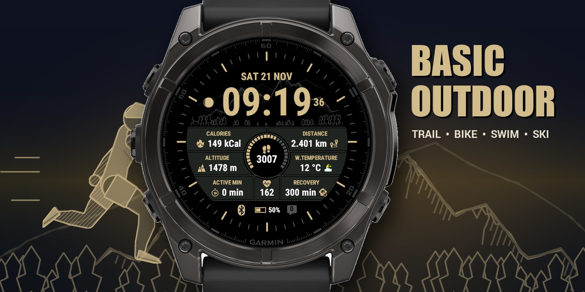
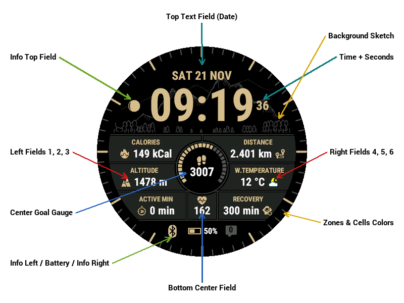
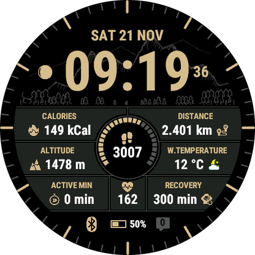
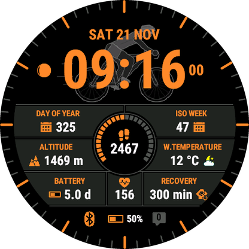
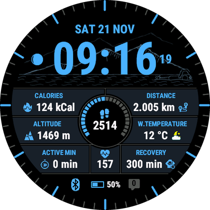
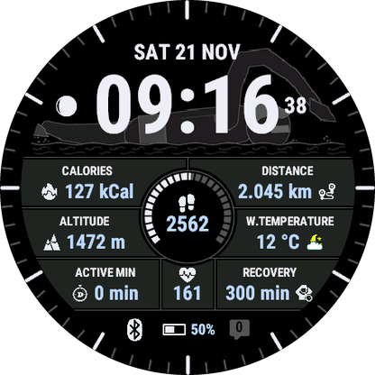
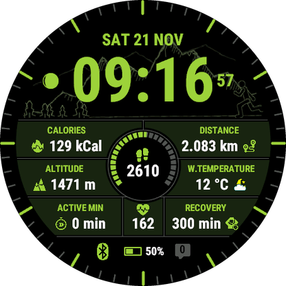
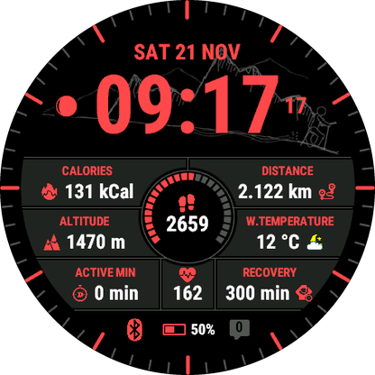
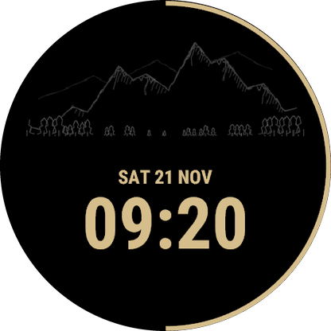
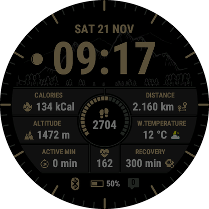

# BASIC OUTDOOR - Documentación Completa

> ⚠️ **AVISO**: Este repositorio contiene únicamente la documentación de usuario. No se incluye código fuente, algoritmos, lógica de servidor ni mecanismos de licencia. Cualquier intento de ingeniería inversa del producto está prohibido.

---

## Índice

1. [Descripción General](#descripción-general)
2. [Funciones Principales](#funciones-principales)
3. [Interfaz de Usuario](#interfaz-de-usuario)
4. [Configuración](#configuración)
   - [Ajustes del Sistema](#ajustes-del-sistema)
   - [Ajustes de Visualización](#ajustes-de-visualización)
   - [Campos de Datos](#campos-de-datos)
   - [Boceto de Fondo](#boceto-de-fondo)
   - [Personalización de Colores](#personalización-de-colores)
   - [Meteorología](#meteorología)
5. [Tipos de Datos Disponibles](#tipos-de-datos-disponibles)
6. [Glosario](#glosario)
7. [Anexos](#anexos)

---

---

## Descripción General

**BASIC OUTDOOR** es una esfera outdoor de estilo táctico para relojes Garmin Connect IQ. Una gran hora centrada se muestra sobre un boceto dibujado a mano (montañas, corredor de trail, ciclista, nadador, esquiador...), encima de una cuadrícula estructurada de 7 celdas de datos alrededor de un indicador de objetivo segmentado, con una barra de información en la parte inferior.

### Características Clave

- ⛰️ **Bocetos de Fondo**: 8 fondos dibujados a mano (o ninguno), teñidos del color que elijas
- 🔲 **6 Celdas de Datos**: Título, icono y valor, alrededor del indicador central
- 🎯 **Indicador Central Segmentado**: Progreso del objetivo con icono y valor
- ❤️ **Campo Inferior Central**: Frecuencia cardíaca por defecto
- 🔋 **Barra de Información**: Info Izquierda / Batería / Info Derecha
- 🌙 **Info Superior**: Luna por defecto, a la izquierda de la hora
- 🎨 **30 Colores Personalizables**: Incluidos los fondos de zonas, las celdas, los separadores y cada icono de campo
- 🌦️ **Integración Meteorológica**: Garmin Weather y OpenWeatherMap
- ⚡ **Optimización de Batería**: Modos inteligentes de ahorro de energía
- 🌍 **Soporte Multilingüe**: 19 idiomas disponibles

---

## Funciones Principales

### 1. Visualización de la Hora

- Gran hora centrada en la pantalla
- Formato 12h o 24h
- Segundos mostrados justo después de la hora, en una posición fija en 12h y 24h
- AM/PM mostrado después de los segundos en formato 12h
- Cero inicial opcional para las horas
- Colores independientes para horas, minutos, segundos y separador

### 2. Boceto de Fondo

Un boceto dibujado a mano se muestra en la zona superior, detrás de la hora:

- **Paisajes**: Montañas (por defecto), Corredor de trail, Ciclista, Nadador, Esquiador
- **Siluetas**: Corredor, Ciclista o Nadador ocupando toda la zona superior
- **Ninguno**: Sin fondo
- Color de tinte configurable

### 3. Celdas de Datos

Seis celdas de datos, tres a cada lado del indicador central:

- Título personalizable (o título por defecto del dato)
- Icono con su propio color configurable
- Valor con unidad

### 4. Indicador Central

- Indicador circular segmentado que muestra el progreso del objetivo
- Icono y valor en el centro
- Rango configurable (mín/máx) u objetivo del sistema

### 5. Campo Inferior Central

- Situado bajo el indicador, entre las celdas inferiores
- Icono arriba, valor centrado
- Frecuencia cardíaca por defecto

### 6. Campo de Texto Superior

- Fecha por defecto, encima de la hora
- Tipo de dato totalmente configurable
- Varios modos de visualización y título personalizable

### 7. Campos Info

Cuatro campos info:

1. **Info Superior**: A la izquierda de la hora (iluminación lunar por defecto)
2. **Info Izquierda**: Barra inferior (teléfono conectado por defecto)
3. **Campo Batería**: Centro de la barra inferior (nivel de batería por defecto)
4. **Info Derecha**: Barra inferior (notificaciones por defecto)

### 8. Diseño Estructurado

- Zona superior (fecha / hora), 7 celdas alrededor del indicador, zona inferior (info / batería)
- Cada zona tiene su propio color de fondo
- Líneas separadoras de 1 px con color configurable (u ocultas)

### 9. Meteorología

- **Fuentes**: Garmin Weather y/o OpenWeatherMap
- **Datos disponibles**:
  - Temperatura actual, sensación térmica, mín/máx
  - Descripción e icono del tiempo
  - Humedad
  - Velocidad y dirección del viento
  - Presión atmosférica (OWM)
  - Nubosidad (OWM)
  - Visibilidad (OWM)
  - Probabilidad de precipitación (GW)

---

## Interfaz de Usuario

### Estructura de la Pantalla

*Disposición de BASIC OUTDOOR con todas las zonas configurables*

### Modos de Visualización

#### Modo Pantalla Completa

#### Modo Salvapantallas

Hora y fecha bajo el boceto de fondo de la parte superior y anillo de nivel de batería alrededor de la pantalla.

#### AOD (Always On Display)

### Leyenda
- **Hora**: Hora con segundos y AM/PM
- **Fecha**: Campo de texto superior
- **Info Superior**: Campo info a la izquierda de la hora
- **Boceto de fondo**: Boceto de la zona superior
- **Campos Izquierda / Derecha 1-6**: Celdas de datos
- **Indicador Central**: Indicador de objetivo
- **Campo Inferior Central**: Campo bajo el indicador
- **Info Izquierda / Batería / Info Derecha**: Barra de información inferior

---

## Configuración

### Ajustes del Sistema

#### Frecuencia de Actualización
Controla la frecuencia de actualización de los datos:

- **Actualización Completa**: Actualización completa cada segundo (consumo máximo)
- **Frecuencia Alta**: Actualización alta
- **Frecuencia Media**: Actualización media (recomendada)
- **Frecuencia Baja**: Actualización baja (ahorro de batería)

#### Ahorro de Energía

**Retraso del Salvapantallas**: Minutos antes de activar el salvapantallas (-1 para desactivar)

**Retraso de Apagado de Pantalla**: Minutos antes de apagar la pantalla (-1 para desactivar)

#### Widget

**Abrir Widget con Pulsación Larga**: Abre el widget con una pulsación larga (solo pantalla táctil)

---

### Ajustes de Visualización

#### Formato de Hora

**Formato Militar**:
- `true`: Formato 24 horas
- `false`: Formato 12 horas (AM/PM)

**Cero Inicial en las Horas**:
- `true`: Muestra el cero inicial (01, 02, 03...)
- `false`: Sin cero inicial (1, 2, 3...)

**Modo de Visualización de los Segundos**:
1. **Oculto**: Segundos ocultos
2. **Normal**: Visualización normal
3. **Siempre Activo**: Siempre visibles

#### Formato de Fecha

7 modos de visualización disponibles:

1. `[DS dd Mes]`: Lun 15 Enero
2. `[DS dd/mm]`: Lun 15/01
3. `[dd/mm/aaaa]`: 15/01/2026
4. `[DS Mes dd]`: Lun Enero 15
5. `[Mes dd DS]`: Enero 15 Lun
6. `[DS mm/dd]`: Lun 01/15
7. `[aaaa/mm/dd]`: 2026/01/15

#### Formato de los Campos de Duración

Elige cómo se muestran los valores de duración en la esfera:

1. **Minutos**: `90 min`
2. **Horas:Minutos**: `01:30 h`

---

### Campos de Datos

#### Lista de Campos

| Campo | Dato por defecto | Opciones |
|-------|------------------|----------|
| Indicador Central | Pasos diarios | Tipo de dato, rango mín/máx (vacío = objetivo del sistema) |
| Campo Izquierda Arriba | Calorías quemadas del día | Tipo de dato, título personalizado |
| Campo Izquierda Centro | Altitud | Tipo de dato, título personalizado |
| Campo Izquierda Abajo | Minutos activos del día | Tipo de dato, título personalizado |
| Campo Derecha Arriba | Distancia del día | Tipo de dato, título personalizado |
| Campo Derecha Centro | Temperatura meteorológica | Tipo de dato, título personalizado |
| Campo Derecha Abajo | Tiempo de recuperación | Tipo de dato, título personalizado |
| Campo de Texto Superior | Fecha | Tipo de dato, título personalizado, modo de visualización |
| Campo Inferior Central | Frecuencia cardíaca | Tipo de dato |
| Info Izquierda | Teléfono conectado | Tipo de dato |
| Campo Batería | Batería en porcentaje | Tipo de dato |
| Info Derecha | Número de notificaciones | Tipo de dato |
| Info Superior (izquierda de la hora) | Iluminación lunar | Tipo de dato |

#### Títulos Personalizados

Deja el título personalizado vacío para usar el título por defecto del dato. Los títulos se muestran en mayúsculas encima del valor.

#### Modos de Visualización del Campo de Texto Superior

0. **Valor**: Solo el valor
1. **Título + Valor**: Título y valor
2. **Valor + Unidad**: Valor con unidad
3. **Valor + Título**: Valor con título
4. **Título + Valor + Unidad**: Título, valor, unidad

---

### Boceto de Fondo

**Boceto de fondo de la zona superior**:

| Opción | Descripción |
|--------|-------------|
| Ninguno | Sin boceto de fondo |
| Montañas | Cordillera con abetos sobre la línea separadora (por defecto) |
| Corredor de trail | Montañas, sendero y corredor |
| Ciclista | Colinas, carretera y ciclista |
| Nadador | Lago, olas y nadador |
| Esquiador | Montañas, pendiente, huellas de esquí y esquiador |
| Silueta carrera | Corredor detallado ocupando toda la zona superior |
| Silueta ciclismo | Ciclista detallado ocupando toda la zona superior |
| Silueta natación | Nadador detallado ocupando toda la zona superior |

**Color del boceto de fondo**: Color de tinte del boceto. Elige el mismo color que el fondo de la zona superior para ocultarlo.

---

### Personalización de Colores

BASIC OUTDOOR ofrece **30 colores personalizables**:

| ID | Elemento |
|----|----------|
| 0 | Color de fondo |
| 1 | Marcas de minutos y separadores |
| 2 | Marcas de horas |
| 3 | Texto de la fecha |
| 4 | Horas |
| 5 | Separador de la hora |
| 6 | Minutos |
| 7 | Segundos y AM/PM |
| 8 | Títulos de los campos |
| 9 | Icono del indicador central |
| 10 | Valores de los campos |
| 11 | Indicador central Off |
| 12 | Indicador central On |
| 13 | Icono del campo inferior central |
| 14 | Info Off |
| 15 | Info Izquierda On |
| 16 | Icono de batería |
| 17 | Info Derecha On |
| 18 | Fondo de la zona superior |
| 19 | Fondo de las celdas de datos |
| 20 | Fondo de la zona inferior |
| 21 | Info Superior On |
| 22 | Icono campo izquierda arriba |
| 23 | Icono campo izquierda centro |
| 24 | Icono campo izquierda abajo |
| 25 | Icono campo derecha arriba |
| 26 | Icono campo derecha centro |
| 27 | Icono campo derecha abajo |
| 28 | Líneas separadoras de zonas (= fondo para ocultar) |
| 29 | Boceto de fondo (= fondo para ocultar) |

### Paleta de Colores Predefinidos

La esfera ofrece **67 colores predefinidos** organizados por familias.

➡️ **[Ver la lista completa de colores](https://pay.b65dev.com/portfolio/faqs#faq-colors)**

### Opciones de Color Especiales

**Iconos meteorológicos en color**: Colorea los iconos del tiempo según las condiciones

**Colores personalizados**: Define hasta 3 colores personalizados en hexadecimal (formato: `0xffffff` o `ffffff`). Por defecto, el color personalizado 1 es el color de acento arena; los colores 2 y 3 son los grises oscuros de las celdas.

---

### Meteorología

#### Configuración del Proveedor

**Proveedor Meteorológico**: Selección del servicio

1. **Garmin Weather (GW)**: Servicio nativo de Garmin
2. **OpenWeatherMap (OWM)**: Servicio externo que requiere clave API
3. **Garmin Weather + OpenWeatherMap**: Prioridad Garmin, complemento OWM
4. **OpenWeatherMap + Garmin Weather**: Prioridad OWM, complemento Garmin

#### OpenWeatherMap

**Clave API de OpenWeatherMap**: Clave API (32 caracteres máx.)

Para obtener una clave API:
1. Crea una cuenta en [openweathermap.org](https://openweathermap.org)
2. Genera una clave API gratuita
3. Copia la clave en los ajustes

**Última llamada OpenWeatherMap**: Muestra la hora de la última llamada API (solo lectura)

---

### Unidades de Medida

#### Altitud
- Metros (m)
- Pies (ft)

#### Distancia
- Kilómetros (km)
- Millas (mi)
- Millas náuticas internacionales (nm)

#### Temperatura
- Celsius (°C)
- Fahrenheit (°F)
- Kelvin (°K)

**Corrección del sensor de temperatura**: Corrección del sensor (valor numérico)

#### Presión
- Hectopascal (hPa)
- Milímetros de mercurio 0°C (mmHg)
- Pulgadas de mercurio 0°C (inHg)

#### Peso
- Kilogramos (kg)
- Libras (lbs)

#### Velocidad del Viento
- Metros / Segundo (m/s)
- Kilómetros / Hora (km/h)
- Millas / Hora (mi/h)
- Nudos (kn)
- Escala de Beaufort (bf)

#### Dirección del Viento
- **Dirección en grados**: Visualización en grados (000-360)
- **Dirección cardinal**: Visualización cardinal (N, NE, E, SE, S, SO, O, NO)

---

### Ajustes Avanzados

#### Textos Personalizados

**Texto personalizado 1**: Texto libre  
**Texto personalizado 2**: Segundo texto libre

#### Cuenta Atrás

**Día objetivo**: Fecha objetivo de la cuenta atrás  
**Hora objetivo**: Hora objetivo (formato HH:mm:ss, ej.: 14:30:00)

#### Zonas Horarias

Configuración de 4 zonas horarias adicionales:

- **Zona horaria 2**: Formato UTC (ej.: +02:00 o -05:30)
- **Zona horaria 3**: Formato UTC
- **Zona horaria 4**: Formato UTC
- **Zona horaria 5**: Formato UTC

Formato: HH:mm con signo + o - (ej.: `+02:00`, `-05:30`)

#### Juegos de Iconos

**Juego de iconos**:
- **Iconos rellenos**: Iconos sólidos
- **Iconos de contorno**: Iconos contorneados

---

## Tipos de Datos Disponibles

BASIC OUTDOOR admite **más de 76 tipos de datos**. Lista completa:

### Actividad Física

| Tipo | Descripción |
|------|-------------|
| Minutos activos : Día | Minutos activos del día |
| Minutos activos : Semana | Minutos activos de la semana |
| Calorías : Quemadas del día | Calorías quemadas del día |
| Calorías : Activas del día | Calorías activas quemadas |
| Pasos diarios | Número de pasos del día |
| Distancia : Día | Distancia del día |
| Distancia : Semana | Distancia de la semana |
| Pisos subidos : Día | Pisos subidos del día (si está disponible) |

### Distancias Específicas

| Tipo | Descripción |
|------|-------------|
| Distancia ciclismo : Semana | Distancia en bicicleta de la semana |
| Distancia ciclismo : 30 días | Distancia en bicicleta en 30 días |
| Distancia ciclismo : Mes actual | Distancia en bicicleta del mes actual |
| Distancia carrera : Semana | Distancia corriendo de la semana |
| Distancia carrera : 30 días | Distancia corriendo en 30 días |
| Distancia carrera : Mes actual | Distancia corriendo del mes actual |
| Distancia natación : Semana | Distancia nadando en los últimos 7 días |
| Distancia natación : 30 días | Distancia nadando en los últimos 30 días |
| Distancia natación : Mes actual | Distancia nadando desde el día 1 del mes |
| Impulsos | Número de impulsos (si está disponible) |
| Distancia de impulsos diaria | Distancia en silla del día (si está disponible) |

### Salud y Bienestar

| Tipo | Descripción |
|------|-------------|
| Frecuencia cardíaca | Frecuencia cardíaca actual |
| FC Mín/Máx (4 horas) | FC mín/máx en 4 horas |
| Body Battery | Nivel de Body Battery (si está disponible) |
| Nivel de estrés | Nivel de estrés (si está disponible) |
| Frecuencia respiratoria | Frecuencia respiratoria (si está disponible) |
| Saturación de oxígeno | SpO2 (si está disponible) |
| Tiempo de recuperación | Tiempo de recuperación (si está disponible) |
| Peso | Peso en kg |

### Rendimiento Deportivo

| Tipo | Descripción |
|------|-------------|
| VO2 Máx Ciclismo | VO2 Máx en ciclismo (si está disponible) |
| VO2 Máx Carrera | VO2 Máx en carrera (si está disponible) |
| Predicción 5K | Tiempo previsto en 5 km |
| Predicción 10K | Tiempo previsto en 10 km |
| Predicción Media Maratón | Tiempo previsto en media maratón |
| Predicción Maratón | Tiempo previsto en maratón |

### Sistema y Batería

| Tipo | Descripción |
|------|-------------|
| Batería en días | Autonomía en días |
| Batería en porcentaje | Nivel de batería en % |
| Intensidad solar | Intensidad solar (si está disponible) |
| Teléfono conectado | Teléfono conectado |
| Número de alarmas | Número de alarmas |
| Número de notificaciones | Número de notificaciones |
| Alerta de inactividad | Nivel de alerta de inactividad |
| No molestar | Modo no molestar activado |

### Entorno

| Tipo | Descripción |
|------|-------------|
| Altitud | Altitud actual (si está disponible) |
| Presión del sensor | Presión atmosférica (si está disponible) |
| Temperatura del sensor | Temperatura del sensor (si está disponible) |

### Meteorología (Garmin Weather)

| Tipo | Descripción |
|------|-------------|
| Temperatura meteorológica | Temperatura |
| Sensación térmica | Sensación térmica |
| Temperatura Mín / Máx | Temperaturas mín/máx (solo GW) |
| Humedad | Humedad |
| Probabilidad de precipitación | Probabilidad de precipitación (solo GW) |
| Viento velocidad/dirección | Velocidad y dirección del viento |

### Meteorología (OpenWeatherMap)

| Tipo | Descripción |
|------|-------------|
| Nubosidad | Nubosidad (solo OWM) |
| Presión meteorológica | Presión (solo OWM) |
| Visibilidad | Visibilidad (solo OWM) |

### Sol y Luna

| Tipo | Descripción |
|------|-------------|
| Salida del sol | Salida del sol |
| Puesta del sol | Puesta del sol |
| Próximo evento solar | Próxima salida o puesta |
| Amanecer civil | Amanecer civil |
| Anochecer civil | Anochecer civil |
| Edad lunar | Edad de la luna |
| Iluminación lunar | Iluminación de la luna |
| Fase lunar | Fase de la luna |

### Fecha y Hora

| Tipo | Descripción |
|------|-------------|
| Fecha | Fecha actual |
| Día del año | Día del año |
| Semana del año | Semana del año |
| Zona horaria 2 | Zona horaria 2 |
| Zona horaria 3 | Zona horaria 3 |
| Zona horaria 4 | Zona horaria 4 |
| Zona horaria 5 | Zona horaria 5 |
| Cuenta atrás | Cuenta atrás |

### Personalización

| Tipo | Descripción |
|------|-------------|
| Texto personalizado | Texto personalizado 1 |
| Texto personalizado 2 | Texto personalizado 2 |
| Campo oculto | Campo oculto |

> Algunos tipos de datos solo están disponibles para ciertos campos (p. ej. el indicador central solo acepta datos con objetivo; los campos info aceptan datos de tipo on/off).

---

## Glosario

- **AMOLED**: Pantalla de diodos orgánicos emisores de luz de matriz activa
- **AOD**: Always On Display (pantalla siempre encendida)
- **API**: Interfaz de programación de aplicaciones
- **Connect IQ**: Plataforma de Garmin para aplicaciones de terceros
- **GW**: Garmin Weather (servicio meteorológico de Garmin)
- **OWM**: OpenWeatherMap (servicio meteorológico externo)
- **SpO2**: Saturación de oxígeno
- **VO2 Máx**: Consumo máximo de oxígeno
- **UTC**: Tiempo universal coordinado

---

## Anexos

### Formatos de los Parámetros

#### Colores Personalizados
Formato hexadecimal: `0xRRGGBB` o `RRGGBB`
- RR = Rojo (00-FF)
- GG = Verde (00-FF)
- BB = Azul (00-FF)

Ejemplo: `0xFF0000` = Rojo puro

#### Zonas Horarias
Formato: `±HH:mm`
- Signo + para el Este, - para el Oeste
- HH = Horas (00-14)
- mm = Minutos (00 o 30)

Ejemplos:
- `+01:00` = UTC+1 (Madrid)
- `-05:00` = UTC-5 (Nueva York)
- `+05:30` = UTC+5:30 (India)

#### Hora de la Cuenta Atrás
Formato: `HH:mm:ss`
- HH = Horas (00-23)
- mm = Minutos (00-59)
- ss = Segundos (00-59)

Ejemplo: `14:30:00` = 14:30

### Códigos de las Fases Lunares

Las fases lunares se numeran del 0 al 7:
- 0: Luna nueva
- 1: Luna creciente
- 2: Cuarto creciente
- 3: Gibosa creciente
- 4: Luna llena
- 5: Gibosa menguante
- 6: Cuarto menguante
- 7: Luna menguante

---

**Última actualización**: 20 de noviembre de 2026  
**Versión del documento**: 0.1 (Beta)  
**Autor**: Bastos65

---

*Este documento se proporciona "tal cual", sin garantía de ningún tipo. El desarrollador se reserva el derecho de modificar las funciones y la documentación sin previo aviso.*
