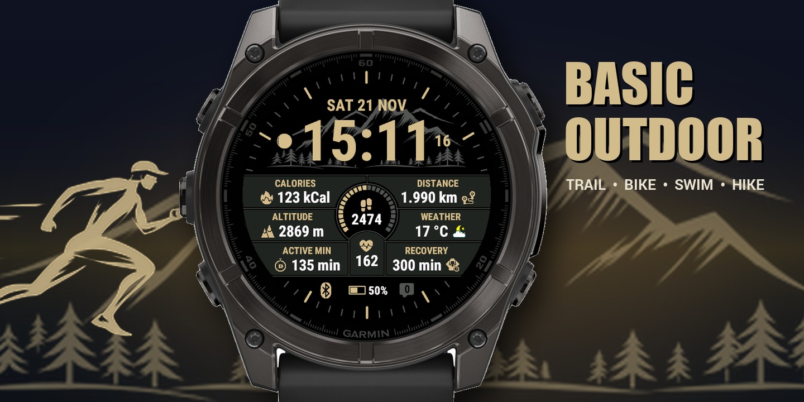
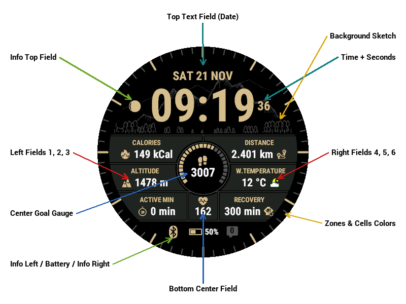
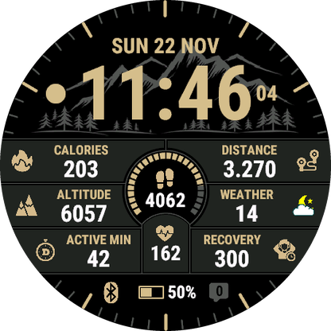
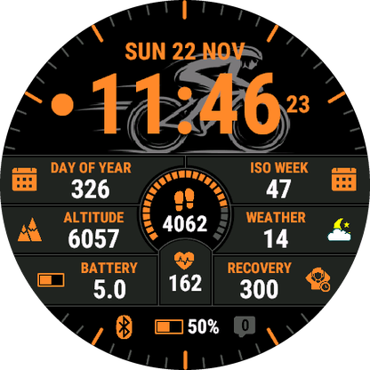
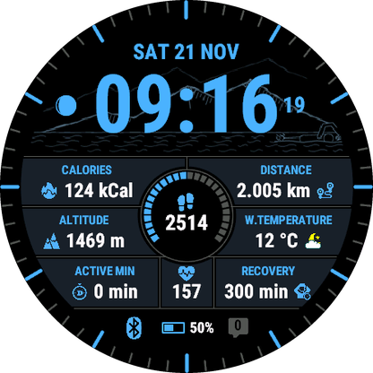
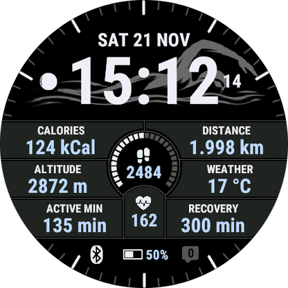
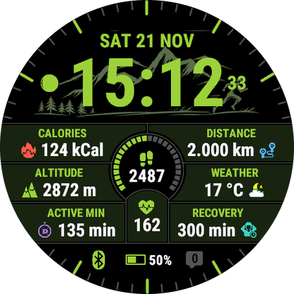
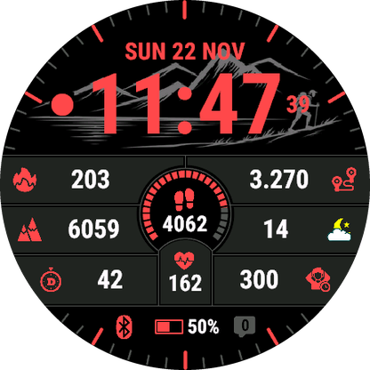
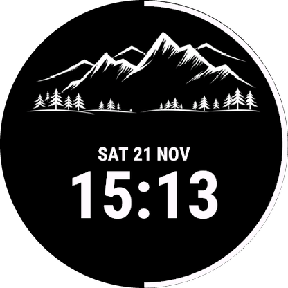
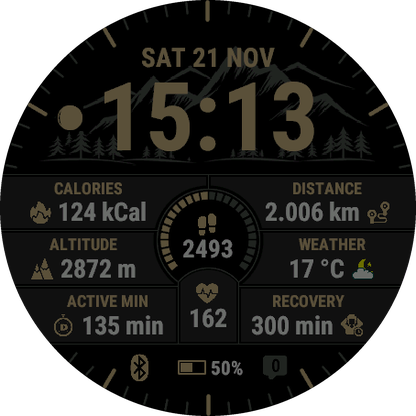

# BASIC OUTDOOR - Documentation Complète

> ⚠️ **AVERTISSEMENT** : Ce dépôt contient uniquement la documentation utilisateur. Aucun code source, algorithme, logique serveur ou mécanisme de licence n'est inclus. Toute tentative de rétro-ingénierie du produit est interdite.

---

## Table des Matières

1. [Vue d'ensemble](#vue-densemble)
2. [Fonctionnalités Principales](#fonctionnalités-principales)
3. [Interface Utilisateur](#interface-utilisateur)
4. [Configuration](#configuration)
   - [Paramètres Système](#paramètres-système)
   - [Paramètres d'Affichage](#paramètres-daffichage)
   - [Champs de Données](#champs-de-données)
   - [Esquisse de Fond](#esquisse-de-fond)
   - [Personnalisation des Couleurs](#personnalisation-des-couleurs)
   - [Météo](#météo)
5. [Types de Données Disponibles](#types-de-données-disponibles)
6. [Glossaire](#glossaire)
7. [Annexes](#annexes)

---

---

## Vue d'ensemble

**BASIC OUTDOOR** est un cadran outdoor au style tactique pour les montres Garmin Connect IQ. Une grande heure centrée s'affiche sur une esquisse dessinée à la main (montagnes, coureur trail, cycliste, randonneur, lac, silhouettes sportives...), au-dessus d'une grille structurée de 7 cellules de données entourant une jauge d'objectif segmentée, avec une barre d'informations en bas.

### Caractéristiques Clés

- ⛰️ **Esquisses de Fond** : 8 fonds dessinés à la main (ou aucun), teintés de la couleur de votre choix
- 🔲 **6 Cellules de Données** : Titre, icône et valeur, disposées autour de la jauge centrale
- 🎯 **Jauge Centrale Segmentée** : Progression de l'objectif avec icône et valeur
- ❤️ **Champ Bas Centre** : Fréquence cardiaque par défaut
- 🔋 **Barre d'Informations** : Info Gauche / Batterie / Info Droite
- 🌙 **Info Haut** : Lune par défaut, à gauche de l'heure
- 🎨 **31 Couleurs Personnalisables** : Dont les fonds de zones, les cellules, les séparations et chaque icône de champ
- 🌦️ **Intégration Météo** : Garmin Weather et OpenWeatherMap
- ⚡ **Optimisation Batterie** : Modes économie d'énergie intelligents
- 🌍 **Support Multilingue** : 19 langues disponibles

---

## Fonctionnalités Principales

### 1. Affichage de l'Heure

- Grande heure centrée sur l'écran
- Format 12h ou 24h
- Secondes affichées juste après l'heure, à une position fixe en 12h comme en 24h
- AM/PM affiché après les secondes en format 12h
- Zéro de tête optionnel pour les heures
- Couleurs indépendantes pour les heures, minutes, secondes, séparateur

### 2. Esquisse de Fond

Une esquisse dessinée à la main s'affiche dans la zone haute, derrière l'heure :

- **Paysages** : Montagnes (par défaut), Coureur trail, Cycliste, Randonneur, Lac
- **Silhouettes** : grande silhouette de coureur, cycliste ou nageur
- **Aucun** : Pas de fond
- Teinte de couleur configurable

### 3. Cellules de Données

Six cellules de données, trois de chaque côté de la jauge centrale :

- Titre personnalisable (ou titre par défaut de la donnée)
- Icône avec sa propre couleur configurable
- Valeur avec unité

### 4. Jauge Centrale

- Jauge circulaire segmentée indiquant la progression de l'objectif
- Icône et valeur au centre
- Plage configurable (min/max) ou objectif système

### 5. Champ Bas Centre

- Situé sous la jauge, entre les cellules du bas
- Icône au-dessus, valeur centrée
- Fréquence cardiaque par défaut

### 6. Champ Texte Haut

- Date par défaut, au-dessus de l'heure
- Type de donnée entièrement configurable
- Plusieurs modes d'affichage et titre personnalisable

### 7. Champs Info

Quatre champs info :

1. **Info Haut** : À gauche de l'heure (illumination de la lune par défaut)
2. **Info Gauche** : Barre du bas (connexion téléphone par défaut)
3. **Champ Batterie** : Centre de la barre du bas (niveau de batterie par défaut)
4. **Info Droite** : Barre du bas (notifications par défaut)

### 8. Mise en Page Structurée

- Zone haute (date / heure), 7 cellules autour de la jauge, zone basse (infos / batterie)
- Chaque zone a sa propre couleur de fond
- Lignes de séparation de 1 px de couleur configurable (ou masquées)
- Graduations heures / minutes uniquement autour des zones haute et basse : les cellules vont jusqu'au bord de l'écran pour des valeurs plus grandes
- Arc inversé sous la jauge pour laisser plus de place au champ bas centre

### 9. Météo

- **Sources** : Garmin Weather et/ou OpenWeatherMap
- **Données disponibles** :
  - Température actuelle, ressentie, min/max
  - Description et icône météo
  - Humidité
  - Vitesse et direction du vent
  - Pression atmosphérique (OWM)
  - Couverture nuageuse (OWM)
  - Visibilité (OWM)
  - Probabilité de précipitations (GW)

---

## Interface Utilisateur

### Structure de l'Écran

*Disposition de BASIC OUTDOOR montrant toutes les zones configurables*

### Modes d'Affichage

#### Mode Affichage Complet

#### Mode Économiseur d'Écran

Heure et date sous l'esquisse de fond de la partie haute (centrées verticalement sans esquisse) icône et niveau de batterie en bas (même place qu'en affichage complet). Tout utilise la **Couleur économiseur d'écran** (blanc par défaut).

#### AOD (Always On Display)

### Légende
- **Heure** : Heure avec secondes et AM/PM
- **Date** : Champ texte haut
- **Info Haut** : Champ info à gauche de l'heure
- **Esquisse de fond** : Esquisse de la zone haute
- **Champs Gauche / Droite 1-6** : Cellules de données
- **Jauge Centrale** : Jauge d'objectif
- **Champ Bas Centre** : Champ sous la jauge
- **Info Gauche / Batterie / Info Droite** : Barre d'informations du bas

---

## Configuration

### Paramètres Système

#### Fréquence de Rafraîchissement
Contrôle la fréquence de mise à jour des données :

- **Rafraîchissement Complet** : Mise à jour complète chaque seconde (consommation maximale)
- **Rafraîchissement Élevé** : Rafraîchissement élevé
- **Rafraîchissement Moyen** : Rafraîchissement moyen (recommandé)
- **Rafraîchissement Faible** : Rafraîchissement faible (économie de batterie)

#### Économie d'Énergie

**Délai Économiseur d'Écran** : Délai en minutes avant l'activation de l'économiseur d'écran (-1 pour désactiver)

**Délai Extinction Écran** : Délai en minutes avant l'extinction de l'écran (-1 pour désactiver)

#### Widget

**Lancer le Widget par Appui Long** : Lance le widget par un appui long (écran tactile uniquement)

---

### Paramètres d'Affichage

#### Format de l'Heure

**Format Militaire** :
- `true` : Format 24 heures
- `false` : Format 12 heures (AM/PM)

**Zéro de Tête des Heures** :
- `true` : Affiche le zéro de tête (01, 02, 03...)
- `false` : Sans zéro de tête (1, 2, 3...)

**Mode d'Affichage des Secondes** :
1. **Caché** : Secondes masquées
2. **Normal** : Affichage normal des secondes
3. **Toujours Actif** : Toujours affichées

#### Format de la Date

7 modes d'affichage disponibles :

1. `[JDS jj Mois]` : Lun 15 Janvier
2. `[JDS jj/mm]` : Lun 15/01
3. `[jj/mm/aaaa]` : 15/01/2026
4. `[JDS Mois jj]` : Lun Janvier 15
5. `[Mois jj JDS]` : Janvier 15 Lun
6. `[JDS mm/jj]` : Lun 01/15
7. `[aaaa/mm/jj]` : 2026/01/15

#### Format des Champs de Durée

Choisissez l'affichage des valeurs de durée sur le cadran :

1. **Minutes** : `90 min`
2. **Heures:Minutes** : `01:30 h`

---

### Champs de Données

#### Liste des Champs

| Champ | Donnée par défaut | Options |
|-------|-------------------|---------|
| Jauge Centrale | Pas quotidiens | Type de donnée, plage min/max (vide = objectif système) |
| Champ Gauche Haut | Calories brûlées du jour | Type de donnée, titre personnalisé |
| Champ Gauche Milieu | Altitude | Type de donnée, titre personnalisé |
| Champ Gauche Bas | Minutes actives du jour | Type de donnée, titre personnalisé |
| Champ Droite Haut | Distance du jour | Type de donnée, titre personnalisé |
| Champ Droite Milieu | Température météo (titre « WEATHER ») | Type de donnée, titre personnalisé |
| Champ Droite Bas | Temps de récupération | Type de donnée, titre personnalisé |
| Champ Texte Haut | Date | Type de donnée, titre personnalisé, mode d'affichage |
| Champ Bas Centre | Fréquence cardiaque | Type de donnée |
| Info Gauche | Téléphone connecté | Type de donnée |
| Champ Batterie | Batterie en pourcentage | Type de donnée |
| Info Droite | Nombre de notifications | Type de donnée |
| Info Haut (à gauche de l'heure) | Illumination de la lune | Type de donnée |

#### Affichage des Titres, Icônes et Unités

**Afficher les titres des 6 champs latéraux** / **Afficher les icônes des 6 champs latéraux** / **Afficher les unités des 6 champs latéraux** (activés par défaut) : masque les titres, les icônes et/ou les unités des 6 cellules. Les éléments restants sont recentrés dans la cellule et les valeurs passent dans une police plus grande.

#### Titres Personnalisés

Laissez le titre personnalisé vide pour utiliser le titre par défaut de la donnée. Les titres s'affichent en majuscules au-dessus de la valeur.

#### Modes d'Affichage du Champ Texte Haut

0. **Valeur** : Valeur seule
1. **Titre + Valeur** : Titre et valeur
2. **Valeur + Unité** : Valeur avec unité
3. **Valeur + Titre** : Valeur avec titre
4. **Titre + Valeur + Unité** : Titre, valeur, unité

---

### Esquisse de Fond

**Esquisse de fond zone haute** :

| Option | Description |
|--------|-------------|
| Aucun | Pas d'esquisse de fond |
| Montagnes | Chaîne de montagnes avec sapins (par défaut) |
| Coureur trail | Montagnes, sapins et coureur trail |
| Cycliste | Montagnes, sapins et cycliste |
| Randonneur | Montagnes, bord de lac et randonneur |
| Lac | Montagnes reflétées dans un lac, randonneur sur un rocher |
| Silhouette course | Grande silhouette de coureur |
| Silhouette vélo | Grande silhouette de cycliste |
| Silhouette natation | Grande silhouette de nageur |

**Couleur esquisse de fond** : Teinte de l'esquisse. Choisissez la même couleur que le fond de la zone haute pour la masquer.

---

### Personnalisation des Couleurs

BASIC OUTDOOR offre **31 couleurs personnalisables** :

| ID | Élément |
|----|---------|
| 0 | Couleur de fond |
| 1 | Graduations minutes & séparateurs |
| 2 | Graduations heures |
| 3 | Texte de la date |
| 4 | Heures |
| 5 | Séparateur de l'heure |
| 6 | Minutes |
| 7 | Secondes & AM/PM |
| 8 | Titres des champs |
| 9 | Icône de la jauge centrale |
| 10 | Valeurs des champs |
| 11 | Jauge centrale Off |
| 12 | Jauge centrale On |
| 13 | Icône du champ bas centre |
| 14 | Info Off |
| 15 | Info Gauche On |
| 16 | Icône batterie |
| 17 | Info Droite On |
| 18 | Fond de la zone haute |
| 19 | Fond des cellules de données |
| 20 | Fond de la zone basse |
| 21 | Info Haut On |
| 22 | Icône champ gauche haut |
| 23 | Icône champ gauche milieu |
| 24 | Icône champ gauche bas |
| 25 | Icône champ droite haut |
| 26 | Icône champ droite milieu |
| 27 | Icône champ droite bas |
| 28 | Lignes de séparation des zones (= fond pour masquer) |
| 29 | Esquisse de fond (= fond pour masquer) |
| 30 | Économiseur d'écran (heure, date, esquisse, batterie) |

### Palette de Couleurs Prédéfinies

Le cadran propose **67 couleurs prédéfinies** organisées par famille.

➡️ **[Voir la liste complète des couleurs](https://pay.b65dev.com/portfolio/faqs#faq-colors)**

### Options de Couleur Spéciales

**Icônes météo colorées** : Colore les icônes météo selon les conditions

**Couleurs personnalisées** : Définissez jusqu'à 3 couleurs personnalisées en hexadécimal (format : `0xffffff` ou `ffffff`). Par défaut, la couleur personnalisée 1 est la couleur d'accent sable, les couleurs 2 et 3 sont les gris foncés des cellules.

---

### Météo

#### Configuration du Fournisseur

**Fournisseur Météo** : Choix du service météo

1. **Garmin Weather (GW)** : Service Garmin natif
2. **OpenWeatherMap (OWM)** : Service externe nécessitant une clé API
3. **Garmin Weather + OpenWeatherMap** : Priorité Garmin, complément OWM
4. **OpenWeatherMap + Garmin Weather** : Priorité OWM, complément Garmin

#### OpenWeatherMap

**Clé API OpenWeatherMap** : Clé API OpenWeatherMap (32 caractères max)

Pour obtenir une clé API :
1. Créez un compte sur [openweathermap.org](https://openweathermap.org)
2. Générez une clé API gratuite
3. Copiez la clé dans les paramètres

**Dernier appel OpenWeatherMap** : Affiche l'heure du dernier appel API (lecture seule)

---

### Unités de Mesure

#### Altitude
- Mètres (m)
- Pieds (ft)

#### Distance
- Kilomètres (km)
- Miles (mi)
- Milles nautiques internationaux (nm)

#### Température
- Celsius (°C)
- Fahrenheit (°F)
- Kelvin (°K)

**Correction capteur de température** : Correction du capteur de température (valeur numérique)

#### Pression
- Hectopascal (hPa)
- Millimètres de mercure 0°C (mmHg)
- Pouces de mercure 0°C (inHg)

#### Poids
- Kilogrammes (kg)
- Livres (lbs)

#### Vitesse du Vent
- Mètres / Seconde (m/s)
- Kilomètres / Heure (km/h)
- Miles / Heure (mi/h)
- Nœuds (kn)
- Échelle de Beaufort (bf)

#### Direction du Vent
- **Direction en degrés** : Affichage en degrés (000-360)
- **Direction cardinale** : Affichage cardinal (N, NE, E, SE, S, SO, O, NO)

---

### Paramètres Avancés

#### Textes Personnalisés

**Texte personnalisé 1** : Texte libre à afficher  
**Texte personnalisé 2** : Second texte libre

#### Compte à Rebours

**Jour cible** : Date cible du compte à rebours  
**Heure cible** : Heure cible (format HH:mm:ss, ex : 14:30:00)

#### Fuseaux Horaires

Configuration de 4 fuseaux horaires supplémentaires :

- **Fuseau 2** : Format UTC (ex : +02:00 ou -05:30)
- **Fuseau 3** : Format UTC
- **Fuseau 4** : Format UTC
- **Fuseau 5** : Format UTC

Format : HH:mm avec signe + ou - (ex : `+02:00`, `-05:30`)

#### Jeux d'Icônes

**Jeu d'icônes** :
- **Icônes pleines** : Icônes remplies
- **Icônes contour** : Icônes détourées

---

## Types de Données Disponibles

BASIC OUTDOOR prend en charge **plus de 76 types de données**. Voici la liste complète :

### Activité Physique

| Type | Description |
|------|-------------|
| Minutes actives : Jour | Minutes actives du jour |
| Minutes actives : Semaine | Minutes actives de la semaine |
| Calories : Brûlées du jour | Calories brûlées du jour |
| Calories : Actives du jour | Calories actives brûlées |
| Pas quotidiens | Nombre de pas du jour |
| Distance : Jour | Distance du jour |
| Distance : Semaine | Distance de la semaine |
| Étages montés : Jour | Étages montés du jour (si disponible) |

### Distances Spécifiques

| Type | Description |
|------|-------------|
| Distance vélo : Semaine | Distance à vélo de la semaine |
| Distance vélo : 30 jours | Distance à vélo sur 30 jours |
| Distance vélo : Mois en cours | Distance à vélo du mois en cours |
| Distance course : Semaine | Distance en course de la semaine |
| Distance course : 30 jours | Distance en course sur 30 jours |
| Distance course : Mois en cours | Distance en course du mois en cours |
| Distance natation : Semaine | Distance de natation sur les 7 derniers jours glissants |
| Distance natation : 30 jours | Distance de natation sur les 30 derniers jours glissants |
| Distance natation : Mois en cours | Distance de natation depuis le 1er du mois |
| Poussées | Nombre de poussées (si disponible) |
| Distance poussées du jour | Distance en fauteuil du jour (si disponible) |

### Santé et Bien-être

| Type | Description |
|------|-------------|
| Fréquence cardiaque | Fréquence cardiaque actuelle |
| FC Min/Max (4 heures) | FC min/max sur 4 heures |
| Body Battery | Niveau Body Battery (si disponible) |
| Niveau de stress | Niveau de stress (si disponible) |
| Fréquence respiratoire | Fréquence respiratoire (si disponible) |
| Saturation en oxygène | SpO2 (si disponible) |
| Temps de récupération | Temps de récupération (si disponible) |
| Poids | Poids en kg |

### Performances Sportives

| Type | Description |
|------|-------------|
| VO2 Max Vélo | VO2 Max vélo (si disponible) |
| VO2 Max Course | VO2 Max course (si disponible) |
| Prédiction 5K | Temps prédit sur 5 km |
| Prédiction 10K | Temps prédit sur 10 km |
| Prédiction Semi-marathon | Temps prédit sur semi-marathon |
| Prédiction Marathon | Temps prédit sur marathon |

### Système et Batterie

| Type | Description |
|------|-------------|
| Batterie en jours | Autonomie en jours |
| Batterie en pourcentage | Niveau de batterie en % |
| Intensité solaire | Intensité solaire (si disponible) |
| Téléphone connecté | Téléphone connecté |
| Nombre d'alarmes | Nombre d'alarmes |
| Nombre de notifications | Nombre de notifications |
| Alerte d'inactivité | Niveau d'alerte d'inactivité |
| Ne pas déranger | Mode ne pas déranger activé |

### Environnement

| Type | Description |
|------|-------------|
| Altitude | Altitude actuelle (si disponible) |
| Pression capteur | Pression atmosphérique (si disponible) |
| Température capteur | Température du capteur (si disponible) |

### Météo (Garmin Weather)

| Type | Description |
|------|-------------|
| Température météo | Température météo |
| Température ressentie | Température ressentie |
| Température Min / Max | Températures min/max (GW uniquement) |
| Humidité | Humidité |
| Probabilité de précipitations | Probabilité de précipitations (GW uniquement) |
| Vent vitesse/direction | Vitesse et direction du vent |

### Météo (OpenWeatherMap)

| Type | Description |
|------|-------------|
| Couverture nuageuse | Couverture nuageuse (OWM uniquement) |
| Pression météo | Pression (OWM uniquement) |
| Visibilité | Visibilité (OWM uniquement) |

### Soleil et Lune

| Type | Description |
|------|-------------|
| Lever du soleil | Lever du soleil |
| Coucher du soleil | Coucher du soleil |
| Prochain événement solaire | Prochain lever ou coucher |
| Aube civile | Aube civile |
| Crépuscule civil | Crépuscule civil |
| Âge de la lune | Âge de la lune |
| Illumination de la lune | Illumination de la lune |
| Phase de la lune | Phase de la lune |

### Date et Heure

| Type | Description |
|------|-------------|
| Date | Date du jour |
| Jour de l'année | Jour de l'année |
| Semaine de l'année | Semaine de l'année |
| Fuseau 2 | Fuseau horaire 2 |
| Fuseau 3 | Fuseau horaire 3 |
| Fuseau 4 | Fuseau horaire 4 |
| Fuseau 5 | Fuseau horaire 5 |
| Compte à rebours | Compte à rebours |

### Personnalisation

| Type | Description |
|------|-------------|
| Texte personnalisé | Texte personnalisé 1 |
| Texte personnalisé 2 | Texte personnalisé 2 |
| Champ masqué | Champ masqué |

> Certains types de données ne sont disponibles que pour certains champs (par ex. la jauge centrale n'accepte que les données avec objectif, les champs info acceptent les données de type on/off).

---

## Glossaire

- **AMOLED** : Type d'écran à diodes électroluminescentes organiques à matrice active
- **AOD** : Always On Display (écran toujours allumé)
- **API** : Interface de programmation
- **Connect IQ** : Plateforme Garmin pour applications tierces
- **GW** : Garmin Weather (service météo Garmin)
- **OWM** : OpenWeatherMap (service météo externe)
- **SpO2** : Saturation pulsée en oxygène
- **VO2 Max** : Consommation maximale d'oxygène
- **UTC** : Temps universel coordonné

---

## Annexes

### Formats des Paramètres

#### Couleurs Personnalisées
Format hexadécimal : `0xRRVVBB` ou `RRVVBB`
- RR = Rouge (00-FF)
- VV = Vert (00-FF)
- BB = Bleu (00-FF)

Exemple : `0xFF0000` = Rouge pur

#### Fuseaux Horaires
Format : `±HH:mm`
- Signe + pour l'Est, - pour l'Ouest
- HH = Heures (00-14)
- mm = Minutes (00 ou 30)

Exemples :
- `+01:00` = UTC+1 (Paris)
- `-05:00` = UTC-5 (New York)
- `+05:30` = UTC+5:30 (Inde)

#### Heure du Compte à Rebours
Format : `HH:mm:ss`
- HH = Heures (00-23)
- mm = Minutes (00-59)
- ss = Secondes (00-59)

Exemple : `14:30:00` = 14h30

### Codes des Phases de Lune

Les phases de lune sont numérotées de 0 à 7 :
- 0 : Nouvelle lune
- 1 : Premier croissant
- 2 : Premier quartier
- 3 : Gibbeuse croissante
- 4 : Pleine lune
- 5 : Gibbeuse décroissante
- 6 : Dernier quartier
- 7 : Dernier croissant

---

**Dernière mise à jour** : 20 novembre 2026  
**Version du document** : 0.1 (Bêta)  
**Auteur** : Bastos65

---

*Ce document est fourni « tel quel » sans garantie d'aucune sorte. Le développeur se réserve le droit de modifier les fonctionnalités et la documentation sans préavis.*
